# Antara (अन्तरा) — Pre-Therapy Clinical Intake & NLP Intelligence Platform

[](https://www.python.org/)
[](https://fastapi.tiangolo.com/)
[](#)
[](#)

> **Mandatory Clinical Ethics Notice**:
> *Antara generates automated observational insights strictly from self-reported intake dialogue to assist licensed therapists during pre-consultation review. It does not issue clinical or psychiatric diagnoses, nor does it replace professional therapeutic interventions.*

---

## 🌸 Overview

Entering a first therapy session is intimidating. Patients—particularly women navigating burnout, anxiety, or relational distress—frequently enter therapy carrying conversational facades, minimizing their lived pain (`"it's fine"`, `"probably just in my head"`), or holding back vulnerable thoughts.

**Antara** is an ethical, privacy-preserving pre-therapy intake platform that bridges the gap between patient vulnerability and clinical consultation:

1. **Patient Intake Interface (`/`)**: A calm, pacing-aware conversational partner that guides the user through 8 calibrated inquiry stages, tracks draft edits to detect self-censorship, and incorporates an immediate crisis safety circuit-breaker.
2. **Therapist Intelligence Portal (`/therapist`)**: An advanced Clinical NLP pipeline that extracts linguistic hedging, emotion trajectory curves, semantic inconsistencies, retracted vulnerabilities, and recurring life triggers—generating an exportable, high-resolution clinical PDF report.
3. **Cryptographic Erasure Protocol**: Zero-knowledge persistent storage. Client dialogue exists only transiently in RAM and is permanently deallocated with memory zeroization (`0x00`) and a SHA-256 audit proof upon session closure.

---

## 🏛️ System Architecture

```mermaid
flowchart TD
    subgraph ClientFlow ["Module 1: Patient Conversational Intake (/)"]
        A[Informed Consent & Privacy Check] --> B[8-Stage Adaptive Intake Dialogue]
        B -->|Live Text Stream| C{Crisis Classifier}
        C -->|Trigger Detected| C1[Emergency Circuit-Breaker: Tele-MANAS / KIRAN Helpline]
        C -->|Safe| D[Draft & Edit Diff Tracker]
        D --> E[Completed Intake Transcript]
    end

    subgraph NLPEngine ["Module 2: Clinical NLP Analytics Engine"]
        E --> F[Report Synthesizer]
        F --> G1[Linguistic Hedging & Minimization Detector]
        F --> G2[Multi-Stage Emotion & Trajectory Analyzer]
        F --> G3[Cross-Stage Semantic Inconsistency Detector]
        F --> G4[Self-Censorship & Token Edit-Diff Analyzer]
        F --> G5[Domain & Situational Trigger Extractor]
    end

    subgraph OutputsVault ["Outputs & Privacy Preservation"]
        G1 & G2 & G3 & G4 & G5 --> H[Structured 6-Section Clinical Report]
        H --> I[Therapist Interactive Dashboard]
        H --> J[Clinical PDF Generator - ReportLab]
        I & J --> K[Volatile Erasure Vault]
        K --> L[Buffer Overwrite 0x00 + SHA-256 Audit Certificate]
    end
```



---

## 🧠 Key NLP & Clinical Intelligence Components

### 1. Linguistic Hedging & Minimization Detector (`nlp_engine/hedging_detector.py`)
* **Clinical Purpose**: Identifies conversational downplaying common in patients struggling with perfectionism, imposter syndrome, or relational conditioning.
* **Tracked Categories**:
  * *Downplayers*: `"it's fine"`, `"not a big deal"`, `"probably nothing"`, `"i just overreact"`.
  * *Epistemic Modals & Approximators*: `"i guess"`, `"i suppose"`, `"sort of"`, `"maybe"`.
  * *Diminutives & Reducers*: `"just"`, `"merely"`, `"a tiny bit"`, `"a little"`.
* **Output**: Computes hedging density, answers-hedged ratio, and clinical significance markers.

### 2. Multi-Stage Emotion & Valence Trajectory (`nlp_engine/emotion_analyzer.py`)
* **Clinical Purpose**: Tracks how the client's internal affective state evolves from polite arrival to deep somatic and relational reflections.
* **Dimensions Analyzed**: *Anxiety/Fear*, *Sadness/Despair*, *Overwhelm/Burnout*, *Guilt/Shame*, *Anger/Resentment*, *Numbness/Detachment*, *Hope/Readiness*, and *Positive/Calm*.
* **Output**: Valence score trajectory ($-1.0$ to $+1.0$), peak distress phase identification, and emotional progression arc.

### 3. Cross-Stage Semantic Inconsistency Detector (`nlp_engine/inconsistency_detector.py`)
* **Clinical Purpose**: Flags discrepancies between an initial socially compliant answer and severe somatic/functional distress revealed later in the session.
* **Detection Archetypes**:
  * *Stated Mood vs. Somatic Reality*: Initial claim of being *"completely fine"* contrasted with subsequent reports of *"chest tightness, trembling, cold sweats"*.
  * *Stated Mood vs. Daily Disruption*: Reporting being *"happy"* followed by *"haven't slept in weeks, wake up at 3 AM crying"*.
  * *Concessive Inversions*: Polite reassurance overturned by adversative transitions (`"Everything is going well, BUT I feel like I'm drowning"`).

### 4. Self-Censorship & Token Edit-Diff Analyzer (`nlp_engine/edit_analyzer.py`)
* **Clinical Purpose**: Uncovers words the patient typed in moments of vulnerability but erased or sanitized before submitting.
* **NLP Technique**: Token-level sequence matching (`difflib.SequenceMatcher`) tracking character additions, deletions, and semantic shifts.
* **Output**: Highlights retracted vulnerability tokens (e.g., *"suffocating"*, *"broken"*, *"terrified"*) replaced with sanitized corporate or polite language.

### 5. Life Domain & Trigger Entity Extractor (`nlp_engine/theme_extractor.py`)
* **Clinical Purpose**: Isolates recurring stressors and environmental patterns.
* **Domains**: *Work & Performance Pressure*, *Interpersonal Conflict & Isolation*, *Somatic Dysregulation*, *Perfectionism & Guilt*.
* **Triggers**: Temporal and situational patterns (e.g., *"Sunday evenings"*, *"messages after 8 PM"*, *"before client presentations"*).

---

## 📑 The 6-Section Clinical Summary

The synthesizer compiles intake findings into a standardized 6-section structure tailored for therapist review:
1. **Client's Primary Concerns (Verbatim)** — Raw, unedited client quotes capturing core pain points.
2. **Emotional Profile & Session Trajectory** — Numerical valence arc and primary affective shifts.
3. **Key Themes & Contextual Triggers** — Life domains, physical manifestations, and situational triggers.
4. **Clinical Observations & Behavioral Markers** — Inconsistencies, hedging density, self-censored edits, and skipped topics.
5. **Client's Stated Goals & Hopes for Therapy** — In her own words, what she hopes to achieve.
6. **Unfiltered Annotated Transcript** — Complete chronological dialogue with timestamps, skip badges, and token edit annotations.

---

## 🛡️ Ephemeral Privacy & Data Erasure Protocol (`storage/erasure_vault.py`)

Mental health intake data demands the highest standard of ethical protection:
* **No Persistent Disk Storage**: Transcripts and generated clinical reports exist exclusively within volatile in-memory data structures.
* **Memory Zeroization**: Upon therapist finalization or manual erasure trigger, underlying memory buffers are overwritten with zeroes (`0x00`) and unreferenced.
* **Cryptographic Proof**: The server issues a verifiable SHA-256 audit receipt containing the timestamp, session hash, and status token without exposing any identifiable dialogue.

---

## 🧪 Pre-Configured Test Personas (`mock_personas/`)

Built-in test cases allow instant demonstration of the clinical NLP engines without manual chat entry:

| Persona | Name | Clinical Profile & NLP Focus |
| :--- | :--- | :--- |
| **`persona_minimizer`** | **Maya** | High hedging density, chronic downplaying (*"it's fine"*, *"I guess"*). |
| **`persona_self_editor`** | **Ananya** | Extensive self-censorship; retractions of emotional vulnerability tokens. |
| **`persona_contradictory`**| **Pooja** | Strong facade masking; opens cheerful, reveals severe somatic panic later. |
| **`persona_burnout`** | **Rhea** | Extreme physical exhaustion (*"wet cement"*, sleep disruption, caregiving strain). |
| **`persona_avoidant`** | **Meera** | Relational detachment; deliberately skips intimate and somatic prompts. |

---

## 📁 Repository Structure

```
Antara/
├── mock_personas/               # Pre-configured clinical test scenarios (.json)
│   ├── persona_avoidant.json
│   ├── persona_burnout.json
│   ├── persona_contradictory.json
│   ├── persona_minimizer.json
│   └── persona_self_editor.json
├── nlp_engine/                  # Core NLP & Computational Linguistics Modules
│   ├── crisis_classifier.py     # Safety circuit-breaker & emergency triage
│   ├── question_bank.py         # 8-stage calibrated conversational questions
│   ├── hedging_detector.py      # Minimization & epistemic modal analysis
│   ├── emotion_analyzer.py      # Multi-dimensional emotion & valence trajectory
│   ├── inconsistency_detector.py# Cross-stage facade & semantic inversion detection
│   ├── edit_analyzer.py         # Difflib-based retracted vulnerability detector
│   ├── theme_extractor.py       # Life domain & environmental trigger extraction
│   └── report_synthesizer.py    # 6-section clinical synthesizer
├── pdf_engine/                  # High-Resolution Clinical PDF Generation
│   └── pdf_generator.py         # ReportLab clinical document formatting
├── storage/                     # Ephemeral Storage & Cryptographic Destruction
│   └── erasure_vault.py         # Volatile memory buffer zeroization & SHA-256 receipts
├── static/                      # Styling & Client-Side Scripts
│   ├── css/
│   │   ├── intake.css           # Calm, accessible patient chat interface
│   │   └── therapist.css        # Professional clinical dashboard styling
│   └── js/
│       ├── intake.js            # Chatbot flow, micro-editing tracker, crisis handler
│       └── therapist.js         # Persona switcher, analytics charts, PDF exporter
├── templates/                   # Frontend Views
│   ├── intake.html              # Patient conversational intake portal (/)
│   └── therapist_portal.html    # Therapist intelligence dashboard (/therapist)
├── main.py                      # FastAPI application server & REST API
├── requirements.txt             # Python dependencies
└── README.md                    # Project documentation
```

---

## 🚀 Quickstart Guide

### Prerequisites
* Python 3.10 or higher
* `pip` package manager

### 1. Clone the Repository
```bash
git clone https://github.com/<your-username>/Antara.git
cd Antara
```

### 2. Set Up a Virtual Environment
```bash
# Windows (PowerShell)
python -m venv venv
.\venv\Scripts\Activate.ps1

# macOS / Linux
python3 -m venv venv
source venv/bin/activate
```

### 3. Install Dependencies
```bash
pip install -r requirements.txt
```

### 4. Run the Platform
```bash
python -m uvicorn main:app --host 127.0.0.1 --port 8000 --reload
```

---

## 🌐 Navigating the Platform

| Portal | URL | Description |
| :--- | :--- | :--- |
| **Patient Intake** | `http://127.0.0.1:8000/` | Guided, reflective 8-stage pre-therapy chat session. |
| **Therapist Dashboard** | `http://127.0.0.1:8000/therapist` | Clinical report view, persona evaluator, PDF export, and data erasure. |
| **OpenAPI / Swagger** | `http://127.0.0.1:8000/docs` | Interactive API documentation for all REST endpoints. |

---

## 🔌 API Reference

* `POST /api/chat/check-crisis` — Scans input for acute self-harm signals and returns emergency triage helpline contacts.
* `POST /api/chat/next-question` — Computes the next conversational prompt based on stage progression and reflections.
* `POST /api/chat/finish` — Ingests a completed session, runs the full NLP pipeline, and executes client memory erasure.
* `GET  /api/personas` — Lists available evaluation personas.
* `GET  /api/personas/{id}` — Fetches raw transcript JSON for a specific persona.
* `POST /api/analyze` — Evaluates arbitrary session transcripts through all 5 NLP engines.
* `GET  /api/report/{session_id}/pdf` — Generates and downloads the ReportLab clinical PDF.
* `POST /api/erase/{session_id}` — Triggers buffer zeroization (`0x00`) and returns cryptographic SHA-256 destruction proof.

---

## 👩‍⚕️ Clinical Safety & Crisis Helplines

If someone using this platform expresses immediate thoughts of self-harm or acute distress, Antara immediately interrupts standard questioning and presents direct helpline access:

* **Tele-MANAS (Govt. of India)**: `14416` or `1800-891-4416` (24/7, Toll-Free)
* **KIRAN Mental Health Helpline**: `1800-599-0019` (24/7, Toll-Free)
* **Vandrevala Foundation**: `+91 9999 666 555` (24/7 Free Counseling)
* **iCall Psychosocial Helpline**: `+91 9152 987 821` (Mon–Sat, 10 AM – 8 PM)
* **International Crisis Resources**: Dial `988` or visit [findahelpline.com](https://findahelpline.com/)

---

## 📜 Academic Attribution & License

Developed as an **NLP Semester Course Project**. Distributed for educational, clinical research, and non-commercial exploration under the [MIT License](LICENSE).
